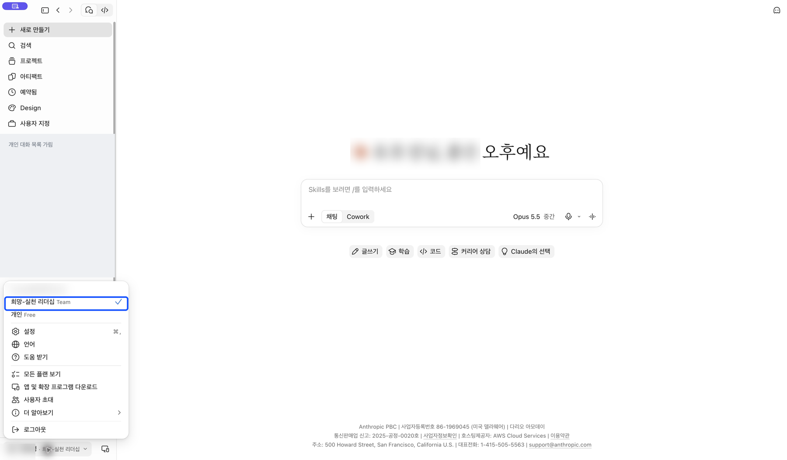
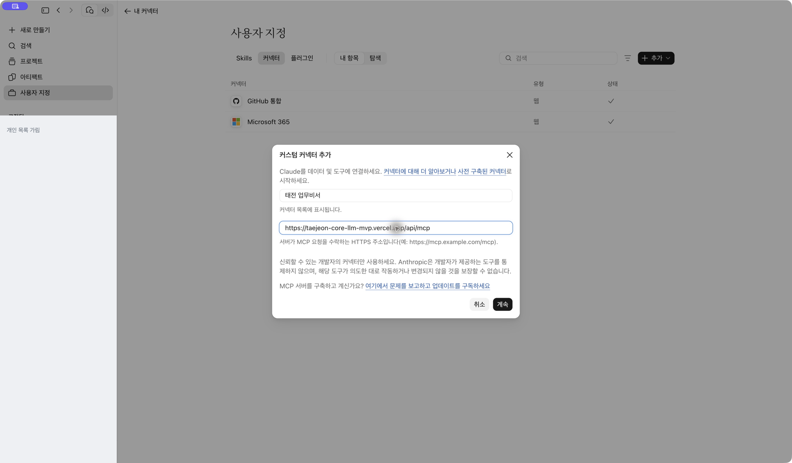
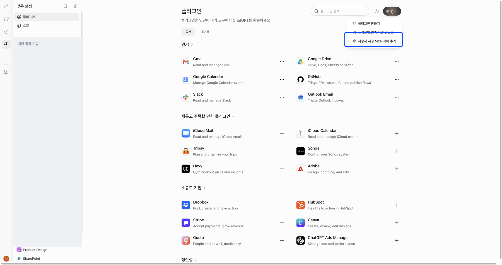

# 태전 업무비서, 처음부터 따라 하기

평소 쓰는 Claude나 ChatGPT에서 회사 자료를 확인해 보세요. **내 계정에 맞게 연결하고, 첫 업무 질문의 답변을 확인하는 것**이 이 가이드의 목표입니다.

> Claude와 ChatGPT는 다른 앱입니다. 아래에서 **지금 사용할 앱과 계정**을 고른 뒤 그 안내만 따라 하세요. 회사 자료를 읽을 때는 별도로 **본인의 태전 회사 계정 인증**을 마칩니다.

## 1. 내 환경을 고르세요

- **Claude 조직 계정이 있어요** → [조직 선택부터 연결하기](docs/guide/claude-team.md)
- **Claude 개인 무료 계정을 써요** → [개인 Free에서 연결하기](docs/guide/claude-free.md)
- **ChatGPT 개인 계정을 써요** → [웹 브라우저에서 연결하기](docs/guide/chatgpt-web.md)
- **휴대폰으로 쓰고 싶어요** → [휴대폰에서 시작하기](docs/guide/mobile.md)
- **ChatGPT·Codex 데스크톱의 ‘마켓플레이스 추가’ 메뉴를 쓰고 있어요** → [데스크톱 전용 설치 안내](docs/guide/chatgpt-desktop.md)

한 사람이 Claude 조직 계정과 개인 ChatGPT를 함께 사용할 수도 있습니다. 이미 연결했다면 중복 설치하지 말고 [첫 질문](#3-첫-질문을-보내세요)으로 이동하세요.

## 2. 화면을 보며 연결하세요

각 안내는 **어디를 누르는지 → 무엇을 입력하는지 → 완료됐는지 확인하는 방법** 순서로 되어 있습니다. 사진은 눌러 크게 볼 수 있습니다.

### Claude 조직 계정

Claude에 **본인 회사의 조직 계정이 있으면 조직 계정으로, 없으면 개인 계정으로** 진행하세요. 조직 계정을 사용한다면 왼쪽 아래 계정 메뉴에서 **본인 회사 조직 이름 옆에 체크 표시가 있는지** 확인하세요. 아래 화면의 조직 이름은 예시이며 회사마다 다릅니다.



그다음 **사용자 지정 → 커넥터 → 내 항목 → 태전 업무비서**로 이동합니다. 처음이면 연결하고, 이미 연결됐다면 새 대화를 엽니다. 항목이 없으면 조직 관리자에게 등록 여부를 문의하세요.

[Claude 조직 계정 안내 계속 보기](docs/guide/claude-team.md)

### Claude 개인 무료 계정

계정 메뉴에서 **개인 Free**를 선택한 뒤 **사용자 지정 → 커넥터 → 추가 → 커스텀 커넥터 추가**를 엽니다. 이름과 서버 주소를 넣고 **계속**을 누릅니다. 다음 화면에서 **지금 로그인 · 자동으로 등록**을 확인한 뒤 **추가**를 누르고 회사 계정으로 연결합니다.

**무료 플랜은 사용자 지정 커넥터를 한 개까지 등록**할 수 있습니다. 이미 태전 업무비서가 있다면 다시 추가하지 마세요. 다른 사용자 지정 연결이 있다면 용도를 확인한 뒤 교체 여부를 결정합니다. 기본 제공 커넥터 전체를 합쳐 한 개라는 뜻은 아닙니다.



[Claude 무료 계정 안내 계속 보기](docs/guide/claude-free.md)

### ChatGPT 개인 계정 — 웹 브라우저

**chatgpt.com → 플러그인 → 추가 → 사용자 지정 MCP 서버 추가**에서 시작합니다. Claude의 커넥터 화면과 다른 경로입니다. 메뉴 제공 여부는 계정·설정에 따라 달라질 수 있습니다.



[ChatGPT 웹 입력 화면과 연결 안내 보기](docs/guide/chatgpt-web.md)

## 3. 첫 질문을 보내세요

연결을 마친 **같은 앱의 새 대화**에서 태전 업무비서를 선택하고 아래처럼 질문하세요. 앱이 연결 대상을 찾지 못하면 앞에 “태전 업무비서로”를 붙이면 됩니다.

```text
전주센터에 레모나 재고 있어?
종류가 여러 개면 먼저 보여줘. 출처와 기준시각도 알려줘.
```

센터명과 제품명은 본인 업무에 맞게 바꾸세요. **센터 코드나 제품 코드를 외워 입력할 필요는 없습니다.** 같은 이름의 제품이 여럿이면 원하는 후보를 선택합니다. 규격·포장이 구분되지 않으면 먼저 차이를 확인해 달라고 하세요.

답변에서 다음 세 가지를 확인하세요.

1. **내가 고른 제품·센터의 결과인가?** 다른 품목이나 다른 센터의 수량이 아닌지 봅니다.
2. **언제 어떤 자료를 조회했는가?** 출처와 조회시각을 확인합니다. 조회시각과 ERP 원천 갱신시각은 다를 수 있습니다.
3. **자료가 없거나 일부만 나온 것은 아닌가?** 미확인·오류·빈 결과를 0으로 읽지 않습니다. 단위가 없으면 ‘개’나 ‘박스’를 임의로 붙이지 않습니다.

**설치됨 → 회사 인증됨 → 실제 조회됨**은 서로 다른 단계입니다. 목록에 보이거나 로그인에 성공한 것만으로 첫 조회가 끝난 것은 아닙니다.

[첫 질문과 답변 확인을 자세히 보기](docs/guide/first-question.md)

## 4. 휴대폰으로 쓰려면

처음 연결은 웹·PC에서 마친 뒤 **같은 AI 계정**으로 모바일 앱에 로그인하는 경로를 권장합니다. Claude 조직 계정 사용자는 모바일에서도 같은 조직을 선택하세요. ChatGPT의 **데스크톱 전용** 플러그인은 모바일에서 사용할 수 없으므로 계정에 사용 가능한 연결이 보이는지 확인합니다.

휴대폰만 있다면 [태전 웹 업무비서](https://taejeon-core-llm-mvp.vercel.app/assistant)에서 회사 계정으로 로그인해 시작할 수도 있습니다. 외부 AI 플러그인을 설치하는 절차와는 별도 경로입니다.

휴대폰으로 이 영상을 보고 있다면 **함께 전달된 안내 링크를 누르세요.** 같은 화면의 QR을 다른 카메라로 다시 찍을 필요는 없습니다.

[휴대폰 사용 순서와 안 보일 때 확인할 점](docs/guide/mobile.md)

## 5. 여기서 막혔나요?

- **Claude 조직에 태전 업무비서가 없어요.** → 올바른 조직인지 확인하고, 조직 관리자에게 등록 여부를 문의하세요.
- **Claude 무료 계정에서 추가가 안 돼요.** → 이미 사용자 지정 연결 한 개가 있는지 확인하세요. 기존 항목을 무조건 삭제하지 마세요.
- **ChatGPT 메뉴가 안내와 달라요.** → 웹과 데스크톱 경로를 구별하세요. 모바일에는 같은 설치 메뉴가 없을 수 있습니다.
- **‘다시 연결’이 보여요.** → 해당 항목에서 본인의 회사 계정으로 재인증하세요.
- **로그인은 했는데 조회가 안 돼요.** → 새 대화에서 연결을 선택하고, [Core 내 연결 상태](https://taejeon-core-llm-mvp.vercel.app/me/mcp)를 확인하세요.

문의할 때는 **사용한 앱, 어느 단계에서 멈췄는지, 오류 문구, 발생 시각**을 알려주세요. 비밀번호·인증 코드·토큰이나 회사 조회 결과를 공개 GitHub 이슈에 올리지 마세요.

[문제 해결 안내](docs/guide/troubleshooting.md)

---

**화면·지원 범위:** 2026-11-02 확인. 개인 정보와 다른 대화는 가렸고 안내용 테두리를 추가했습니다. 조직 선택 체크나 원본 메뉴를 합성하지 않았습니다. 기존 연결의 인증·조회 확인과 새 빈 계정의 최초 설치 검증은 구별합니다. 모바일 앱 실기기에서 태전 연결의 전체 흐름을 검증한 상태는 아닙니다.

[Anthropic 공식 연결 안내](https://support.claude.com/en/articles/11176164-use-connectors-to-extend-claude-s-capabilities) · [OpenAI 플러그인 안내](https://learn.chatgpt.com/docs/plugins) · [OpenAI 웹 MCP 추가 안내](https://developers.openai.com/api/docs/guides/custom-mcp-server)

<details>
<summary>관리·개발 담당자용 문서</summary>

처음 설치하는 직원은 위 안내만 읽으면 됩니다.

- [자료 범위·계정 권한·업데이트·캐시 복구](docs/data-scope-and-maintenance.md)
- [공통 연결 진단](docs/connection-doctor.md)
- [설치 패키지 검사](docs/security-controls.md)
- [ERP 추출 지침](plugins/taejeon-core/skills/erp-extraction/SKILL.md)
- [개편 전 안내 보관본](docs/reference-before-guide-20261102.md)

이 저장소는 연결 설정과 안내를 제공합니다. 문서 개편은 Core 서버의 기능·권한·배포 변경을 의미하지 않습니다.

</details>
