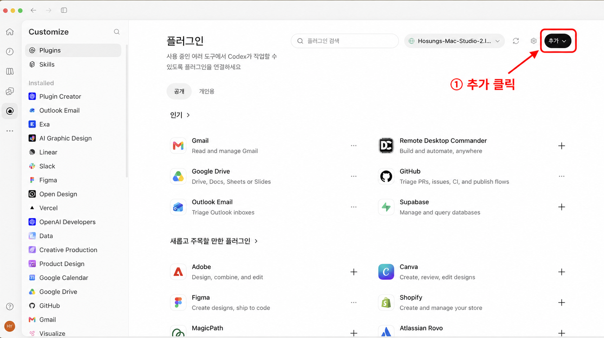
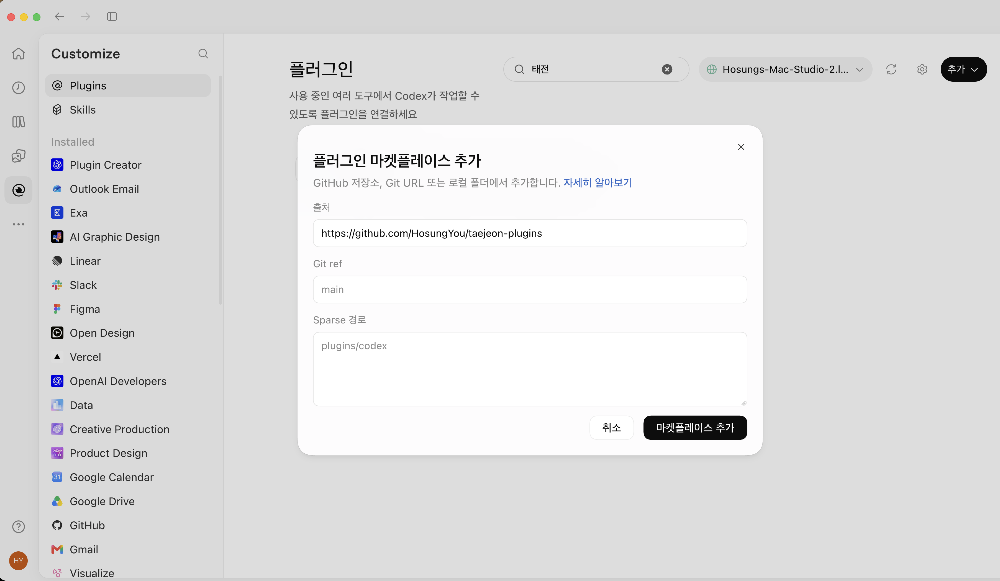
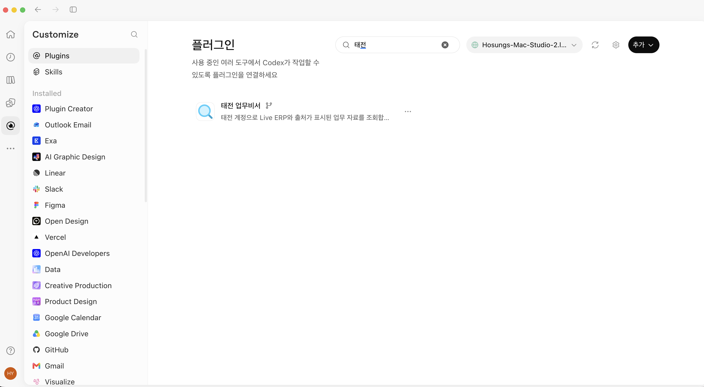
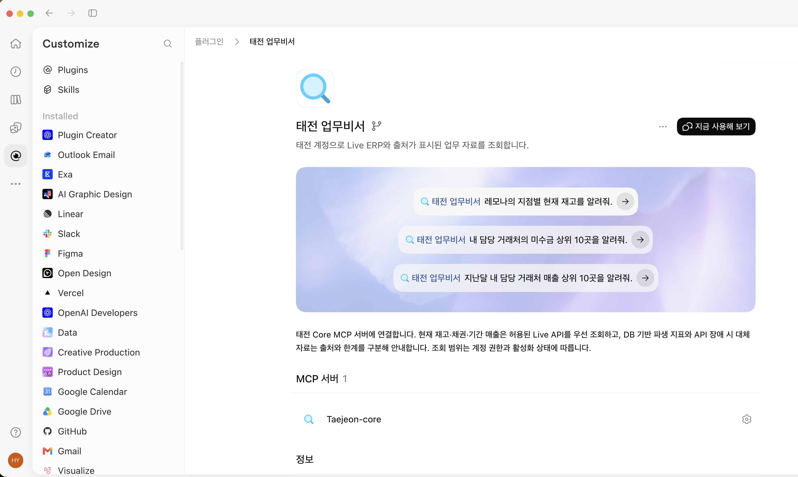

[처음으로](../../README.md) · [Claude 조직](claude-team.md) · [Claude 무료](claude-free.md) · [ChatGPT 웹](chatgpt-web.md) · [휴대폰](mobile.md)

# ChatGPT·Codex 데스크톱 설치

**‘마켓플레이스 추가’ 메뉴가 있는 데스크톱 앱용입니다.** 웹의 사용자 지정 MCP 등록과 별도 절차이며, 이 설치만으로 모바일에 같은 플러그인이 제공된다고 보장하지 않습니다. 사진은 기존 사용자 제공 2026-09-29 화면입니다. 최신 데스크톱 앱 전체 흐름을 이번에 재검증한 것은 아닙니다.

## ChatGPT·Codex 데스크톱 앱에서 설치하기

화면 기준: **2026-09-29 사용자 제공 스크린샷**. 한국어 적용 후에도 `Customize`, `Plugins`, `Installed`, `Git ref` 등 일부 메뉴는 영어로 보일 수 있습니다.

### 1단계 — 태전 마켓플레이스 추가하기

앱 왼쪽의 **Plugins(플러그인)**을 엽니다. 아래 화면의 **오른쪽 위 검은색 ‘추가’ 버튼**을 누르고 **마켓플레이스 추가**를 선택합니다. 개별 플러그인 카드 옆의 `+` 버튼이 아닙니다.



*사용자 제공 화면에 안내용 테두리·화살표를 추가한 이미지입니다. [원본 화면](../images/chatgpt-desktop-00-add-original.png)도 함께 보관합니다.*

다음 창이 나오면 아래 사진처럼 **출처에 태전 GitHub 주소 전체를 입력**합니다.



| 화면에서 찾을 위치 | 입력·선택할 내용 | 확인할 점 |
| --- | --- | --- |
| **① 출처** — 창 중앙의 첫 번째 입력란 | 아래 GitHub 주소 전체를 붙여 넣기 | `/api/mcp` 주소를 넣는 곳이 아닙니다. |
| **② Git ref** — 출처 바로 아래 | `main` | 기본값이 이미 `main`이면 유지합니다. |
| **③ Sparse 경로** — 큰 입력란 | **비워 두기** | 회색 `plugins/codex`는 예시 문구입니다. 따라 입력하지 않습니다. |
| **④ 마켓플레이스 추가** — 창 오른쪽 아래 | 입력 확인 후 클릭 | 위 사진처럼 출처가 입력되면 오른쪽 아래 버튼으로 추가합니다. |

**출처에 붙여 넣을 주소**

```text
https://github.com/HosungYou/taejeon-plugins
```

**출처는 사진에 입력된 위 태전 GitHub 주소와 같아야 합니다.** 공용 비밀번호·토큰을 입력하거나 직원이 GitHub 저장소를 직접 복제할 필요는 없습니다.

> 마켓플레이스 추가는 **설치할 플러그인 목록을 가져오는 단계**입니다. 아직 태전 업무비서의 설치·회사 계정 인증까지 끝난 것은 아닙니다.

### 2단계 — 태전 업무비서 찾고 설치하기

마켓플레이스 추가 후 플러그인 목록으로 돌아옵니다. 상단 검색창에 **태전**을 입력합니다. `taejeon`으로 검색해도 됩니다.



| 화면에서 찾을 위치 | 할 일 |
| --- | --- |
| **① 상단 검색창** — 사진에서 `태전`이 입력된 곳 | `태전` 또는 `taejeon` 입력 |
| **② 검색창 오른쪽 기기 선택란** | 실제로 사용할 기기가 선택돼 있는지 확인. 사진의 기기 이름은 예시이며 그대로 맞출 필요가 없습니다. |
| **③ 검색 결과의 돋보기 아이콘과 ‘태전 업무비서’** | 해당 항목을 클릭해 상세 화면 열기 |
| **④ 상세 화면의 설치(Install)** | 처음 설치하는 경우 클릭. 이미 설치되어 ‘지금 사용해 보기’가 보이면 다음 단계로 이동 |

**검색 결과가 없다면:** 출처 주소를 확인한 뒤 기기 선택란 옆 **새로고침 아이콘**을 누릅니다. 그래도 보이지 않으면 앱을 다시 열어 확인합니다. 마켓플레이스를 같은 이름으로 반복 추가하거나 토큰을 수동으로 입력하지 마세요.

### 3단계 — 서버를 확인하고 새 대화에서 사용하기

설치된 태전 업무비서의 상세 화면입니다. 연결·인증 요청이 나오면 [회사 인증 안내](chatgpt-web.md#3-본인의-태전-회사-계정으로-인증하세요)를 완료합니다. **상단 ‘지금 사용해 보기’**와 **아래 ‘MCP 서버 1 → Taejeon-core’**를 확인합니다.



| 화면에서 찾을 위치 | 할 일 | 주의할 점 |
| --- | --- | --- |
| **① MCP 서버 1 → Taejeon-core** — 화면 아래쪽 | 태전 서버가 등록되어 있는지 확인 | 항목이 보이는 것만으로 인증 완료는 아닙니다. |
| **② Taejeon-core 오른쪽 톱니바퀴** | 연결 상태를 확인하고, 서버 사용 설정이 제공되면 켜져 있는지 확인 | 이 사진에는 상태창·켜짐 스위치가 펼쳐져 있지 않습니다. |
| **③ 지금 사용해 보기** — 화면 오른쪽 위 검은 버튼 | 새 대화에서 태전 업무비서 사용 시작 | 기존 대화에 도구가 보이지 않으면 새 대화를 엽니다. |
| **④ 가운데 예시 질문** | 원하는 질문을 선택하거나 아래 질문을 직접 입력 | 예시 문구는 실제 조회 결과가 아닙니다. |

연결·인증 요청이 표시되면 **본인의 태전 회사 계정**으로 로그인합니다. Microsoft Authenticator 승인, 일회용 코드, 생체 인증 등은 본인이 완료합니다. 비밀번호·인증 코드·토큰을 대화창에 붙여 넣지 마세요. 인증을 마치면 앱으로 돌아옵니다.

**첫 질문 예시**

```text
레모나의 지점별 현재 재고를 알려줘.
조회 결과의 출처와 기준시각도 함께 알려줘.
```

또는:

```text
조회 가능한 업무 데이터와 각 자료의 기준시각을 알려줘.
```

### 4단계 — 실제로 연결됐는지 확인하기

다음 세 가지를 구분해서 확인합니다.

| 확인 단계 | 확인 방법 |
| --- | --- |
| 설치 | 태전 업무비서 상세 화면이 열리고 MCP 서버가 표시됨 |
| 인증 | 회사 계정 로그인 후 연결 오류 없이 앱으로 돌아옴 |
| 조회 | 새 대화에서 실제 태전 도구가 실행되고 결과 또는 권한·자료 부재에 대한 구체적 응답이 돌아옴 |

답변에 **자료의 출처·조회시각·원천 기준시각·부분 결과 여부**가 있는지 확인하세요. Live API 결과인지 DB 대체 자료인지도 확인합니다. 오류나 자료가 없다는 답변을 숫자 0으로 해석하면 안 됩니다.

> 위 스크린샷은 마켓플레이스 입력 창·검색 결과·설치된 상세 화면을 설명합니다. **회사 계정 인증 완료나 실제 업무 조회 성공의 증거 사진은 아닙니다.** 결과 화면에 회사 자료가 포함될 수 있으므로 공개 README에 실제 거래처·직원 자료를 올리지 않습니다.

