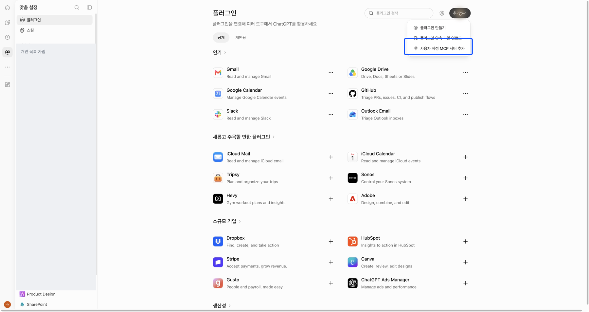
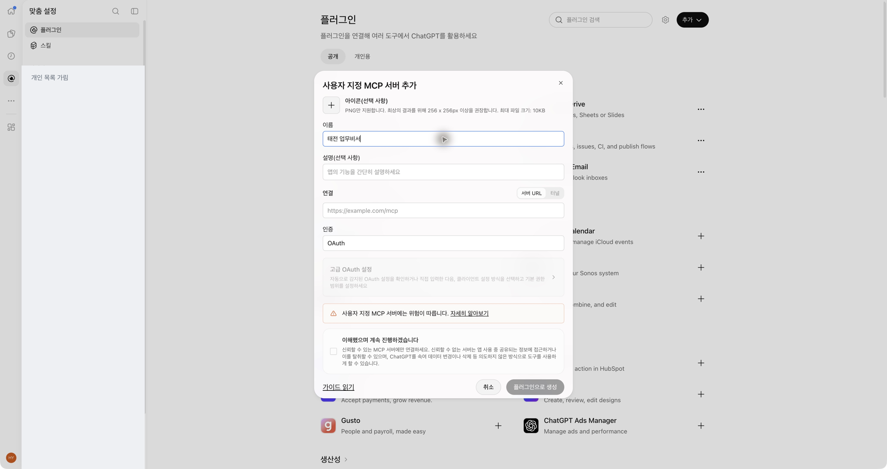
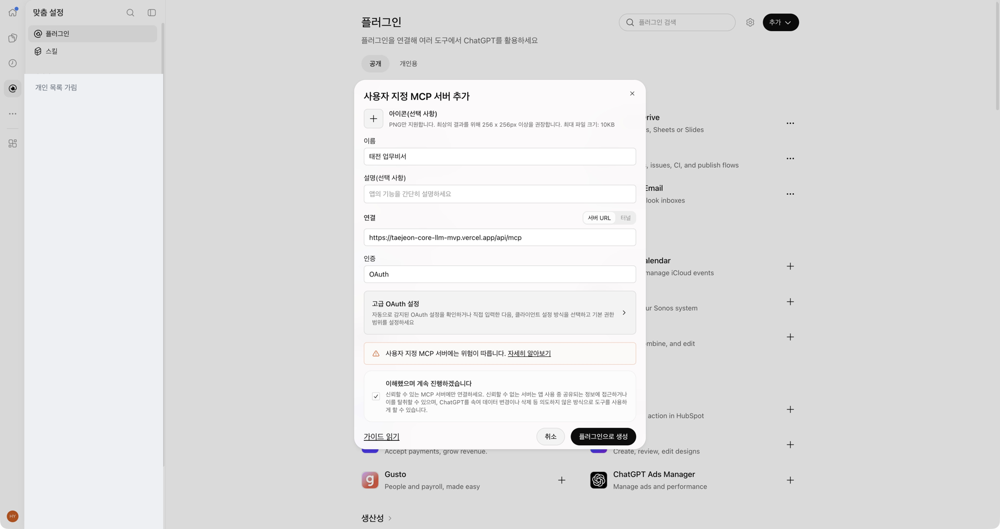
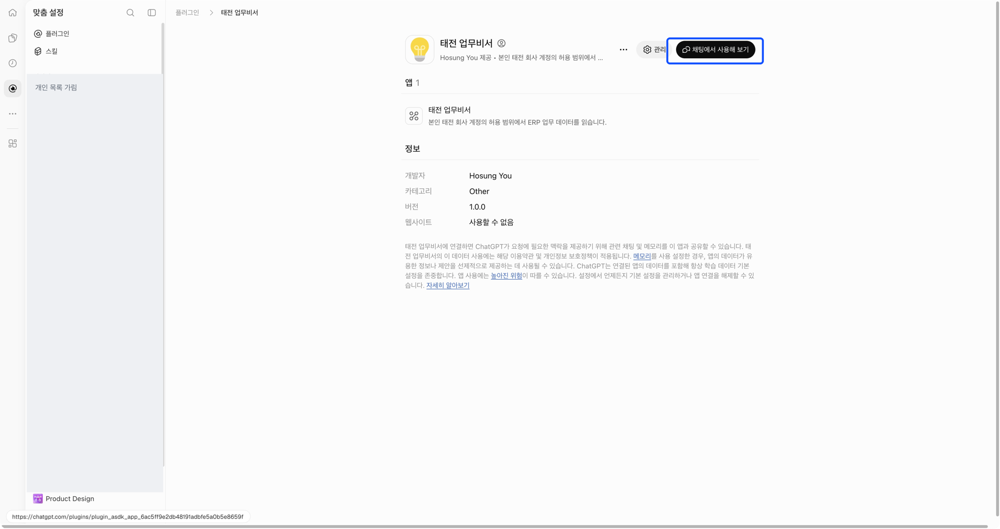

[처음으로](../../README.md) · [Claude 조직](claude-team.md) · [Claude 무료](claude-free.md) · [ChatGPT 웹](chatgpt-web.md) · [휴대폰](mobile.md)

# ChatGPT 개인 계정으로 연결하기 — 웹

**지금 보고 있는 화면은 ChatGPT 웹입니다.** Claude의 ‘커넥터’ 메뉴나 데스크톱의 ‘마켓플레이스 추가’와 섞지 마세요.

## 1. 플러그인 추가 메뉴를 여세요

웹 브라우저에서 [ChatGPT](https://chatgpt.com)를 엽니다. 본인 개인 계정으로 로그인한 뒤 **플러그인 → 오른쪽 위 추가 → 사용자 지정 MCP 서버 추가**를 선택합니다.



이 메뉴가 보이지 않으면 계정·설정·지원 범위를 확인하세요. 안내와 다른 화면에서 같은 메뉴를 무작정 찾기보다 [다른 설치 경로](chatgpt-desktop.md) 또는 [휴대폰 안내](mobile.md)를 확인합니다.

## 2. 이름과 서버 주소를 차례로 입력하세요

- 이름: **태전 업무비서**
- 연결: **서버 URL**
- 인증: **OAuth**

서버 URL에는 아래 주소를 복사해 넣습니다.

```text
https://taejeon-core-llm-mvp.vercel.app/api/mcp
```

먼저 **이름** 칸에 ‘태전 업무비서’를 입력합니다.



다음으로 위 주소를 **서버 URL** 칸에 붙여 넣고, **인증**이 **OAuth**인지 확인하세요.



연결 대상과 위험 안내를 읽고 **이해했으며 계속 진행하겠습니다**를 체크한 뒤 **플러그인으로 생성**을 누릅니다. 필요한 설치·회사 인증 요청을 이어 완료합니다. 추가 OAuth 비밀정보를 임의로 발급하거나 타인의 토큰을 넣지 마세요.

이미 태전 업무비서가 설치돼 있으면 다시 만들지 않습니다. 촬영 계정은 기존 연결이 있어 위 양식 입력 후 취소했고 기존 연결로 조회했습니다.

## 3. 본인의 태전 회사 계정으로 인증하세요

ChatGPT 로그인과 회사 자료 조회 인증은 별개입니다. 연결 요청의 Microsoft 로그인에서 본인의 태전 회사 계정을 사용합니다. 추가 인증이 나오면 본인이 완료한 뒤 **ChatGPT로 돌아옵니다**.

## 4. ChatGPT에서 새 대화를 여세요

설치된 태전 업무비서의 **채팅에서 사용해 보기**를 누르거나, 새 대화에서 태전 업무비서를 선택하세요.



[코드 없이 첫 질문 보내기](first-question.md)로 이어갑니다. 연결 항목이 보이는 것과 실제 조회 성공은 구별해서 확인합니다.

[휴대폰에서 이어 쓰기](mobile.md)
