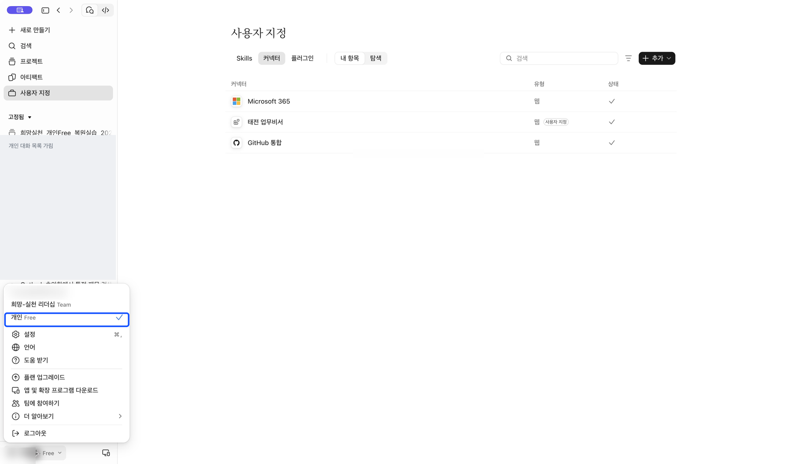
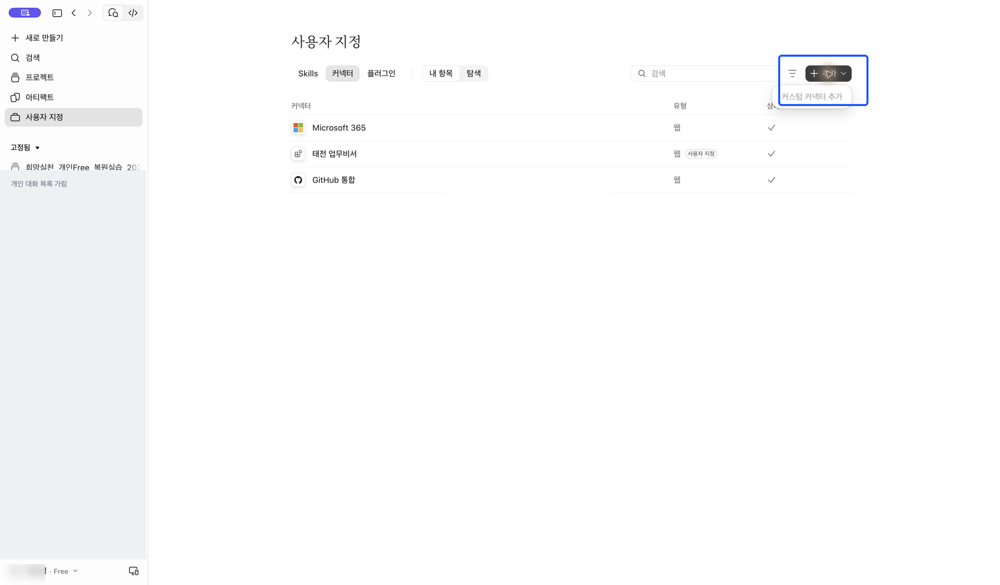
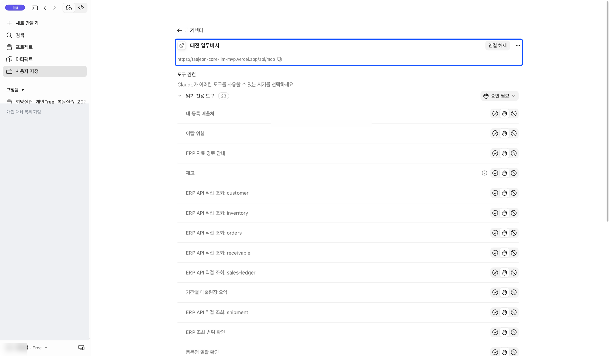

[처음으로](../../README.md) · [Claude 조직](claude-team.md) · [Claude 무료](claude-free.md) · [ChatGPT 웹](chatgpt-web.md) · [휴대폰](mobile.md)

# Claude 개인 무료 계정으로 연결하기

**목표:** 개인 Free 계정에 태전 업무비서 연결을 하나 등록하고 회사 인증을 마칩니다.

## 1. 개인 Free가 선택됐는지 확인하세요

왼쪽 아래 계정 메뉴에서 **개인 Free 옆의 체크**를 확인하세요.



## 2. 이미 연결했는지 먼저 보세요

**사용자 지정 → 커넥터 → 내 항목**에 태전 업무비서가 있다면 중복 추가하지 않습니다. 연결 또는 다시 연결을 눌러 진행하세요.

**무료 제한은 사용자 지정 커넥터 한 개**입니다. 기본 제공 커넥터 전체를 합쳐 한 개라는 뜻은 아닙니다. 아래 사진처럼 이미 한 개가 있으면 추가 메뉴가 비활성화될 수 있습니다. 기존 연결이 다른 업무에 쓰이는지 확인한 뒤 교체 여부를 결정하세요.



## 3. 처음이라면 이름과 서버 주소를 추가하세요

**사용자 지정 → 커넥터 → 추가 → 커스텀 커넥터 추가**로 이동합니다. 버전에 따라 **Custom → Web**으로 보일 수도 있습니다.

- 이름: **태전 업무비서**
- 서버 URL: 아래 주소 전체를 복사합니다.

```text
https://taejeon-core-llm-mvp.vercel.app/api/mcp
```

이 칸에는 GitHub 저장소 주소를 넣지 않습니다. 일반 직원은 OAuth Client ID·Client Secret이나 공용 토큰을 직접 입력하지 않습니다. 다음/Continue 뒤의 인증 설정을 확인하고 화면 안내에 따라 추가합니다.

아래는 같은 이름과 서버 주소로 **이미 등록된 연결의 실제 상세 화면**입니다. 새 빈 계정의 최초 추가 창을 촬영한 것으로 표시하지 않습니다.



## 4. 회사 계정으로 인증하고 새 대화를 여세요

연결을 누른 뒤 본인의 태전 회사 계정으로 로그인합니다. 추가 인증이 나오면 본인이 완료하세요. Claude로 돌아와 연결 상태를 확인하고 [첫 질문](first-question.md)을 보냅니다.

[휴대폰에서 이어 쓰기](mobile.md)
