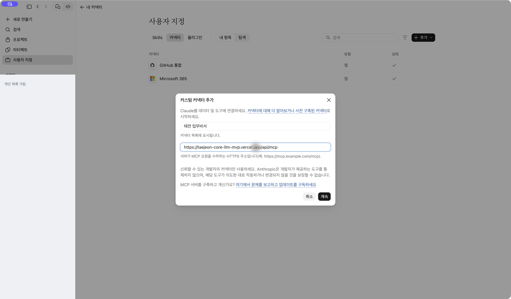
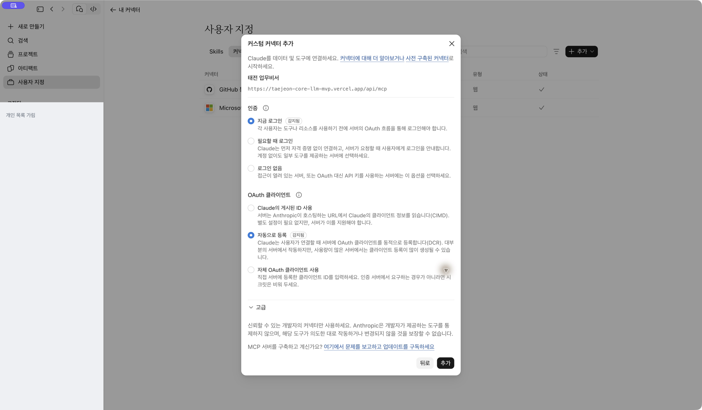
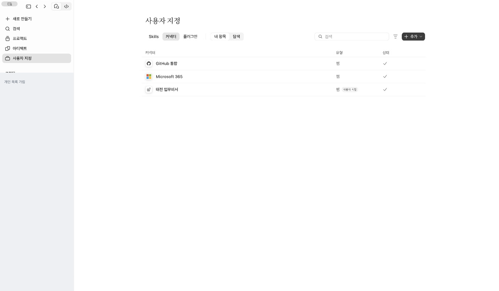

[처음으로](../../README.md) · [Claude 조직](claude-team.md) · [Claude 무료](claude-free.md) · [ChatGPT 웹](chatgpt-web.md) · [휴대폰](mobile.md)

# Claude 개인 무료 계정으로 연결하기

**목표:** 개인 Free 계정에 태전 업무비서 연결을 하나 등록하고 회사 인증을 마칩니다.

## 1. 개인 Free가 선택됐는지 확인하세요

왼쪽 아래 계정 메뉴에서 **개인 Free 옆의 체크**를 확인하세요.


## 2. 이미 연결했는지 먼저 보세요

**사용자 지정 → 커넥터 → 내 항목**에 태전 업무비서가 있다면 중복 추가하지 않습니다. 연결 또는 다시 연결을 눌러 진행하세요.

**무료 제한은 사용자 지정 커넥터 한 개**입니다. 기본 제공 커넥터 전체를 합쳐 한 개라는 뜻은 아닙니다. 아래 사진처럼 이미 한 개가 있으면 추가 메뉴가 비활성화될 수 있습니다. 기존 연결이 다른 업무에 쓰이는지 확인한 뒤 교체 여부를 결정하세요.


## 3. 처음이라면 이름과 서버 주소를 추가하세요

**사용자 지정 → 커넥터 → 추가 → 커스텀 커넥터 추가**로 이동합니다. 버전에 따라 **Custom → Web**으로 보일 수도 있습니다.

- 이름: **태전 업무비서**
- 서버 URL: 아래 주소 전체를 복사합니다.

```text
https://taejeon-core-llm-mvp.vercel.app/api/mcp
```

이 주소는 **MCP 서버 URL** 칸에 넣습니다. GitHub 가이드의 주소와 서버 주소는 서로 다릅니다. 이름과 주소를 모두 입력했으면 **계속**을 누르세요.



### 이어지는 2단계도 확인하세요

다음 화면에서 이름과 서버 주소가 맞는지 한 번 더 확인합니다. 태전 업무비서는 아래와 같이 선택합니다.

1. **인증: 지금 로그인** — 회사 계정으로 연결하는 방식입니다.
2. **OAuth 클라이언트: 자동으로 등록** — 촬영 시 기본으로 선택돼 있던 항목입니다.
3. **추가**를 누릅니다.



일반 직원은 ‘자체 OAuth 클라이언트 사용’을 선택하거나 Client ID·Client Secret을 따로 만들지 않아도 됩니다. ‘로그인 없음’으로 바꾸지 마세요.

## 4. 회사 계정으로 인증하고 새 대화를 여세요

로그인 화면이 나오면 본인의 태전 회사 계정으로 로그인합니다. 추가 인증이 나오면 본인이 완료하세요. 이미 로그인돼 있으면 이 과정이 자동으로 끝날 수도 있습니다.

Claude의 **내 항목**으로 돌아와 태전 업무비서 옆에 **연결됨**이 보이는지 확인합니다. 항목을 열었을 때 ‘연결 해제’가 보이고 도구 목록이 나타나는 것도 연결 상태를 확인하는 방법입니다.



그다음 새 대화에서 [첫 질문](first-question.md)을 보내세요. 연결 목록에 보이는 것과 실제 조회 성공은 각각 확인합니다.

**촬영 확인:** 2026-11-02, 사용자 승인으로 기존 태전 업무비서를 제거한 뒤 같은 이름·서버로 다시 등록했습니다. 입력 → 계속 → 인증 설정 → 추가 → 연결됨까지 확인했습니다. 이 계정에는 기존 로그인 상태가 있어 별도의 회사 로그인 입력 화면은 나오지 않았습니다.

[휴대폰에서 이어 쓰기](mobile.md)
