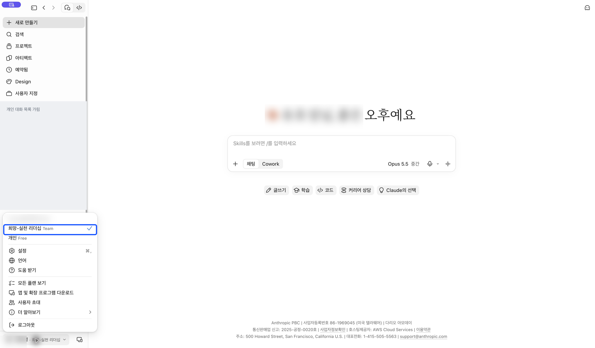
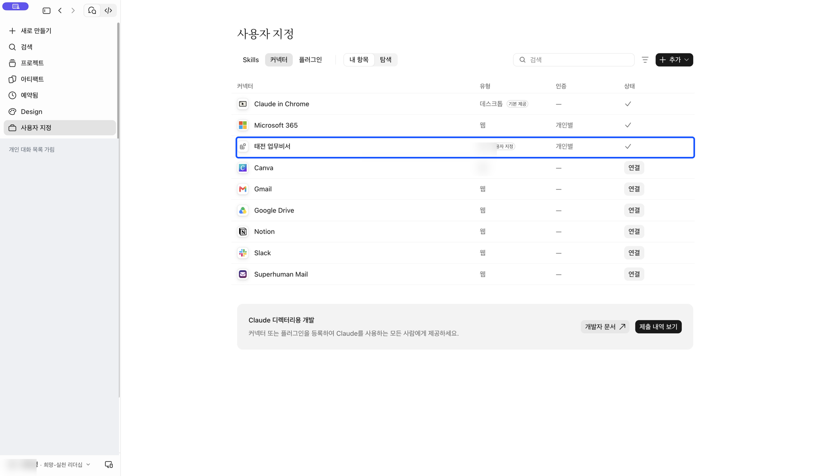

[처음으로](../../README.md) · [Claude 조직](claude-team.md) · [Claude 무료](claude-free.md) · [ChatGPT 웹](chatgpt-web.md) · [휴대폰](mobile.md)

# Claude 조직 계정으로 연결하기

**목표:** 조직이 제공하는 태전 업무비서를 본인의 회사 계정으로 연결합니다.

## 1. 사용할 조직을 확인하세요

Claude 왼쪽 아래 계정 메뉴를 엽니다. **희망-실천 리더십 Team 옆에 체크**가 있어야 합니다. 개인 Free가 선택돼 있다면 조직 이름을 눌러 전환하세요. 다른 조직을 안내받았다면 그 조직명을 사용합니다.

## 2. 내 커넥터에서 태전 업무비서를 찾으세요

왼쪽 **사용자 지정 → 커넥터 → 내 항목**을 엽니다. **태전 업무비서** 행을 찾으세요.

## 3. 회사 계정으로 연결하세요

처음이면 해당 항목의 **연결**을 누릅니다. Microsoft 로그인에서 **본인의 태전 회사 계정**으로 인증하세요. 추가 인증이 나오면 본인이 완료한 뒤 Claude로 돌아옵니다.

이미 연결됨 또는 체크가 보이면 다시 추가할 필요가 없습니다. 이 사진은 **이미 연결된 상태**입니다. 연결 버튼을 누르기 전 화면으로 표시한 것이 아닙니다.

## 4. 새 대화에서 질문하세요

[첫 질문과 답변 확인](first-question.md)으로 이어갑니다. 도구 실행 확인이 나오면 조회 내용을 읽고 허용하세요.

**항목이 없다면:** 개인 Free와 조직 계정을 혼동하지 않았는지 확인하세요. 올바른 조직에도 없다면 조직 소유자의 사전 등록이 필요합니다. 일반 구성원의 추가 메뉴가 비활성화돼 있어도 임의로 다른 조직이나 공용 계정으로 바꾸지 마세요.

[휴대폰에서 이어 쓰기](mobile.md)
