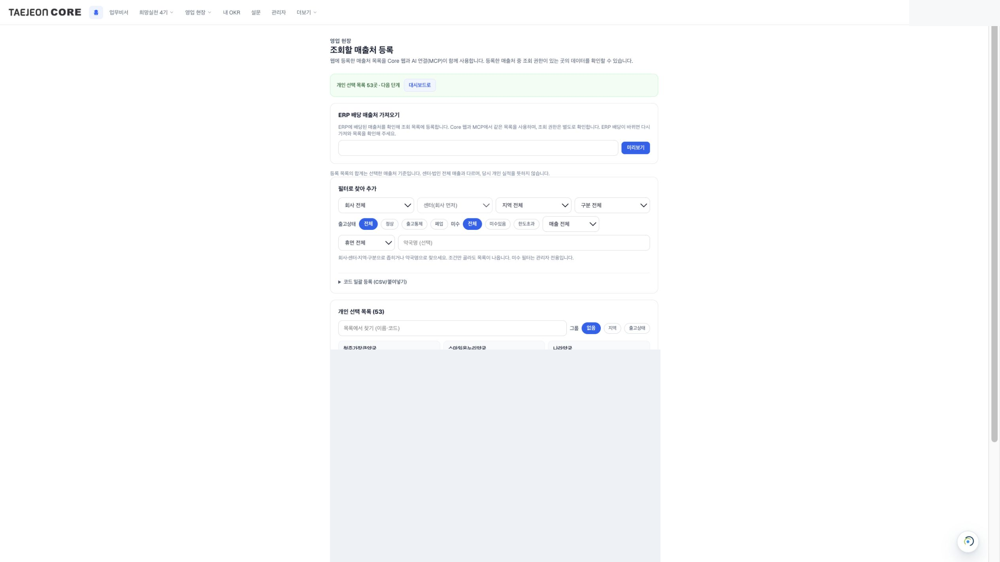
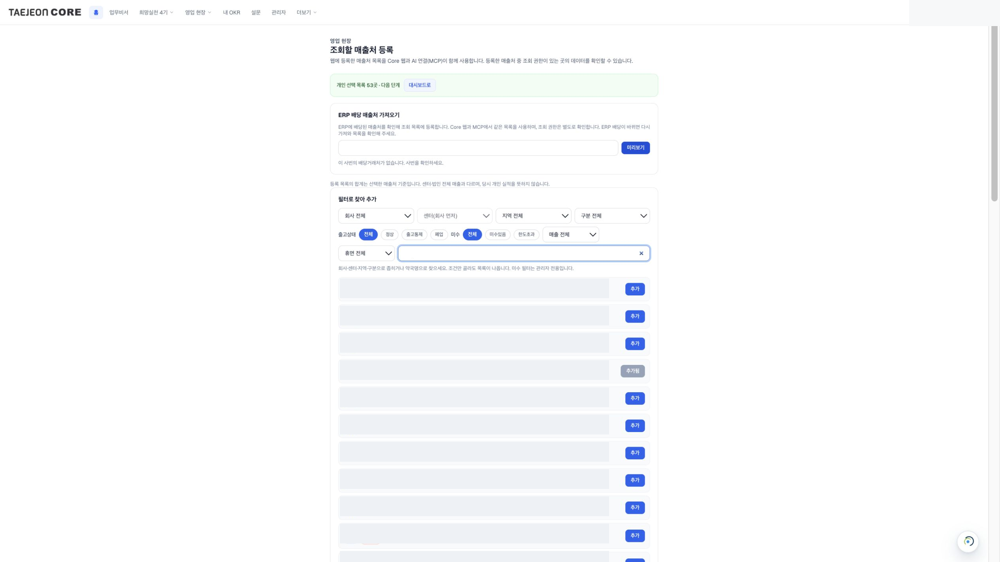

[처음으로](../../README.md) · [첫 질문](first-question.md)

# 먼저 내 거래처를 등록하세요

**내 거래처의 매출·미수**를 확인하려면 Core에 조회할 거래처를 등록합니다. 재고만 조회한다면 건너뛰어도 됩니다. 이미 등록한 분은 목록만 확인하세요.

## 1. Core에 회사 계정으로 로그인하세요

[조회할 매출처 등록 화면 열기](https://taejeon-core-llm-mvp.vercel.app/me/customers)

화면 제목이 **조회할 매출처 등록**인지 확인하세요. 여기서 등록한 목록을 Core와 AI 업무비서가 함께 사용합니다.

## 2. 거래처 이름으로 찾아 추가하세요

**필터로 찾아 추가**에서 회사·센터를 고르고 거래처 이름을 검색하세요. 결과의 회사·센터·지역과 거래처를 확인한 뒤 맞는 항목의 **추가**를 누릅니다. 같은 이름이 여러 개라면 임의로 고르지 말고 담당 거래처인지 확인하세요. **추가됨**으로 표시된 항목은 이미 등록된 것입니다.

화면 아래 **개인 선택 목록**에 해당 거래처가 들어갔는지 확인하세요. 본인과 관계없는 거래처를 예시대로 등록하지 마세요.

## ERP에 배당된 거래처를 가져오려면

**ERP 배당 매출처 가져오기**에서 **본인 사번**을 확인하고 **미리보기**를 누릅니다. 결과가 나오면 본인 담당 목록이 맞는지 확인한 후 화면의 등록 안내를 따르세요. 배당 거래처가 없다는 안내가 나오면 사번을 확인하거나 위의 이름 검색으로 등록하세요. 다른 사람의 사번을 입력하지 마세요.

이 가이드 촬영에서는 미리보기 결과가 비어 있어 일괄 등록 완료 화면은 촬영하지 않았습니다. 검색의 추가·추가됨 상태와 기존 개인 목록을 확인했으며, 촬영을 위해 실제 등록 목록을 변경하지 않았습니다.

## 3. 같은 회사 계정으로 AI를 연결하세요

[Claude 조직](claude-team.md) · [Claude 개인 무료](claude-free.md) · [ChatGPT 개인](chatgpt-web.md)

연결 후 “내 등록 거래처 목록을 보여줘”로 확인하거나 [필요한 첫 질문](first-question.md)을 골라 보세요. 등록은 조회 대상을 고르는 절차이며 권한을 새로 부여하지 않습니다. 등록한 목록의 합계는 회사·센터 전체 매출이나 당시 개인 실적과 다를 수 있습니다.

휴대폰에서도 위 Core 링크를 열어 같은 회사 계정으로 등록할 수 있습니다. 화면 배치는 기기에 따라 달라질 수 있습니다.
