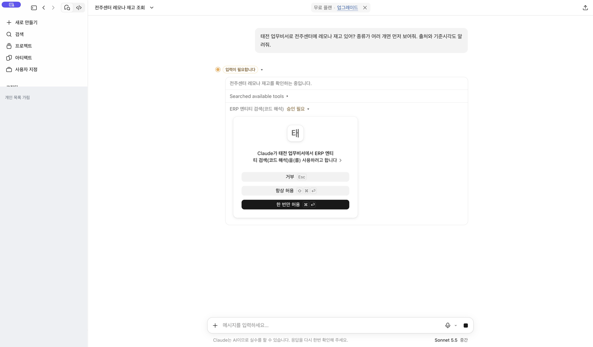

[처음으로](../../README.md) · [Claude 조직](claude-team.md) · [Claude 무료](claude-free.md) · [ChatGPT 웹](chatgpt-web.md) · [휴대폰](mobile.md)

# 코드 없이 첫 질문 보내기

## 1. 새 대화에서 태전 업무비서를 선택하세요

Claude는 연결한 계정·조직에서, ChatGPT는 설치한 개인 계정에서 새 대화를 엽니다. 연결을 찾지 못하면 앞에 “태전 업무비서로”를 붙여 요청하세요.

## 2. 현장에서 쓰는 이름으로 질문하세요

원하는 업무를 하나 골라 질문하세요.

- 재고: “태전약품 전주센터에 레모나(하트캔) 재고 있어?”
- 매출: “내 등록 거래처의 이번 달 매출을 요약해 줘.”
- 미수: “내 등록 거래처 중 미수금이 있는 곳을 보여줘.”

출처와 조회 시각도 함께 요청하세요. **매출·미수는 먼저 [Core에서 내 거래처를 등록](core-customers.md)**하세요. 예시 모두를 실제 검증했다는 뜻은 아니며 조회 권한과 제공 자료에 따라 답변 범위가 달라집니다.

직원이 센터·제품 코드를 찾아 입력하는 절차가 아닙니다. 센터와 제품명은 본인 업무에 맞게 바꾸세요. 어느 법인의 센터인지 애매하면 회사 이름도 말해 주세요.

## 3. 처음 도구 사용을 물어보면 확인하고 허용하세요

Claude에서는 첫 조회 때 태전 업무비서의 도구 사용을 확인하는 창이 나올 수 있습니다. 연결 대상과 조회 내용을 확인한 뒤 **한 번만 허용**을 눌러 주세요. 품목 검색과 재고 조회처럼 다른 도구를 이어 쓸 때 다시 물을 수도 있습니다.



계속 기다리는 것처럼 보여도 **승인 필요** 또는 **입력이 필요합니다**가 있는지 먼저 확인하세요.

## 4. 제품이 여러 개면 골라 주세요

같은 제품명이 여러 코드로 등록될 수 있습니다. 원하는 제품이 명확하면 후보를 선택합니다. 규격·포장이 구분되지 않으면 다음처럼 질문하세요.

```text
같은 이름이 여럿이네. 규격과 포장 차이를 먼저 확인해 줘.
구분이 안 되면 임의로 고르지 말고 알려줘.
```

ERP가 규격 정보를 제공하지 않으면 확인이 더 필요할 수 있습니다. 코드 번호가 답변에 표시되더라도 직원이 그 번호를 외워야 한다는 뜻은 아닙니다.

## 5. 결과와 근거를 확인하세요

- 원하는 제품·센터·기간의 결과인지 확인합니다.
- Live ERP 결과인지 DB 대체 자료인지 출처를 확인합니다.
- API 조회시각과 원천 갱신시각을 구별합니다. 원천 시각이 없으면 미확인으로 읽습니다.
- 원문 수량에 단위가 없으면 ‘개’나 ‘박스’를 임의로 붙이지 않습니다.
- 빈 결과·오류·부분 결과는 0원이나 재고 없음으로 단정하지 않습니다.

촬영·검증은 일회 허용으로 진행했으며 항상 허용 설정으로 바꾸지 않았습니다.

## 다음에 물어볼 수 있는 질문

아래는 활용 예시이며 이 영상에서 모두 실행한 검증 결과는 아닙니다. 각자의 계정 권한과 자료 제공 범위에 따라 달라집니다.

```text
이번 달 내 담당 거래처 매출을 요약해 줘. 조회 기간과 자료 출처도 알려줘.
```

```text
이 거래처의 현재 미수금과 기준시각을 확인해 줘.
```

[자료 범위와 제한](../data-scope-and-maintenance.md)
