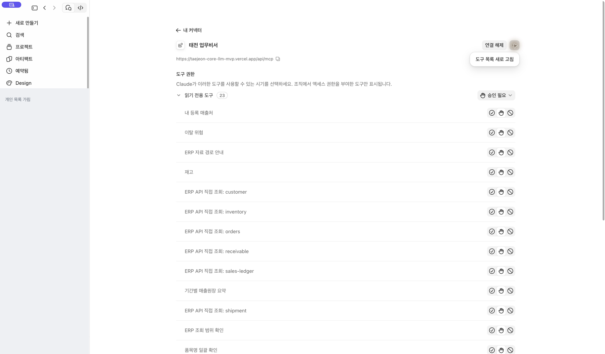

[처음으로](../../README.md) · [Claude 조직](claude-team.md) · [Claude 무료](claude-free.md) · [ChatGPT 웹](chatgpt-web.md) · [휴대폰](mobile.md)

# 연결이 잘되지 않을 때

## 먼저 어느 단계인지 확인하세요

1. **설치:** 태전 업무비서가 목록에 보이나요?
2. **인증:** 본인의 회사 계정으로 로그인하고 원래 앱으로 돌아왔나요?
3. **조회:** 새 대화에서 실제 태전 도구가 실행되고 응답이 돌아왔나요?

## 화면별 해결 방법

### Claude 조직에 항목이 없어요

왼쪽 아래 계정 메뉴에서 조직 옆 체크를 확인합니다. 올바른 조직에도 없으면 조직 관리자에게 사전 등록 여부를 문의하세요.

### Claude 무료에서 추가가 비활성화됐어요

사용자 지정 커넥터 한 개가 이미 있는지 확인합니다. 태전 업무비서가 있다면 그 항목을 연결·다시 연결합니다. 다른 업무 연결을 무조건 지우지 마세요.

### ChatGPT의 메뉴가 달라요

웹·데스크톱·모바일을 구별합니다. 웹에서 Git 마켓플레이스 메뉴를 찾거나, 모바일에 데스크톱 전용 설치가 나타날 것으로 기대하지 마세요. 계정·설정상 지원이 없으면 회사 웹 업무비서 또는 지원 담당자를 이용하세요.

### 인증이 만료되거나 로그인만 반복돼요

해당 연결에서 다시 연결을 선택하고 본인 회사 계정으로 인증합니다. 별도 탭에서 Core 홈페이지에 로그인한 것만으로 연결이 완료되지는 않습니다. [Core 연결 상태](https://taejeon-core-llm-mvp.vercel.app/me/mcp)를 확인하세요.

### 조회 권한이 없거나 자료가 없대요

연결 오류인지 권한·자료 부재인지 구별합니다. 문의할 때 앱·계정 경로·단계·오류 문구·발생 시각을 알려주세요. 조회 결과 전체나 비밀번호·인증 코드·토큰은 공개 이슈에 올리지 않습니다.

구버전이나 캐시 문제는 지원 담당자와 [업데이트·복구 안내](../data-scope-and-maintenance.md)를 확인하세요. 전체 로그인 정보나 다른 플러그인을 삭제하는 것이 기본 해결책은 아닙니다.

### Claude가 오래 기다리는 것처럼 보여요

대화에 **승인 필요 / 입력이 필요합니다**가 있으면 도구 사용 허용을 기다리는 상태일 수 있습니다. 조회 내용을 확인하고 **한 번만 허용**을 눌러 주세요. 다른 도구를 쓰면 다시 확인할 수 있습니다.

### 연결은 되는데 최신 기능을 찾지 못해요

먼저 연결한 계정·조직이 맞는지 확인합니다. Claude는 **사용자 지정 → 커넥터 → 내 항목 → 태전 업무비서 → 더 많은 옵션 → 도구 목록 새로 고침**을 누른 뒤 **새 대화**에서 다시 질문하세요. 연결을 삭제하거나 다른 사람의 계정으로 바꿀 필요는 없습니다.

설치 버전이 표시되는 데스크톱 패키지와 웹의 원격 연결은 서로 다릅니다. 번호가 같아야만 연결되는 것은 아니며, 실제 도구 호출과 결과로 확인합니다. 문의할 때는 사용한 앱과 새 대화에서 입력한 업무 질문을 함께 알려 주세요.
